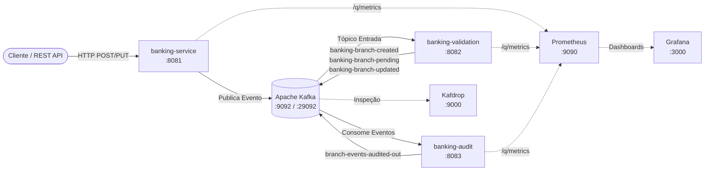

# Ecossistema Bancário Orientado a Eventos (`banking-*`)

Projeto de microsserviços desenvolvido em **Java 21** e **Quarkus 3.15.1 (LTS)** para processamento, validação e auditoria assíncrona de eventos de agências bancárias (`Branch`) utilizando **Apache Kafka** e monitoramento com **Prometheus** e **Grafana**.

---

## Imagens Docker Hub

As imagens oficiais do projeto estão disponíveis no Docker Hub:

* `carberilo/banking-service:1.0.0`
* `carberilo/banking-validation:1.0.0`
* `carberilo/banking-audit:1.0.0`

---

## 1. Arquitetura e Fluxo de Eventos



### Componentes da Infraestrutura (`docker-compose.yml`)

| Serviço / Container | Imagem / Build | Porta Host | Descrição |
| :--- | :--- | :---: | :--- |
| **`banking-kafka`** | `apache/kafka:3.7.0` | `9092` | Broker Apache Kafka em modo **KRaft** (sem Zookeeper), com auto-criação de tópicos habilitada. |
| **`banking-kafdrop`** | `obsidiandynamics/kafdrop:latest` | `9000` | Interface web leve para visualizar tópicos, partições e mensagens JSON no Kafka. |
| **`banking-service`** | `./banking-service` (Dockerfile.jvm) | `8081` | Microsserviço de entrada/domínio que expõe APIs REST (OpenAPI/Swagger) e publica eventos. |
| **`banking-validation`** | `./banking-validation` (Dockerfile.jvm) | `8082` | Microsserviço responsável pelas regras de validação de negócio e roteamento de status (`created`, `pending`, `updated`). |
| **`banking-audit`** | `./banking-audit` (Dockerfile.jvm) | `8083` | Microsserviço consumidor dos tópicos de status que consolida e publica no tópico de auditoria (`branch-events-audited-out`). |
| **`banking-prometheus`** | `prom/prometheus:latest` | `9090` | Coletor de métricas que realiza *scrape* nos endpoints `/q/metrics` dos três microsserviços. |
| **`banking-grafana`** | `grafana/grafana:latest` | `3000` | Plataforma de observabilidade para visualização de métricas (Prometheus) e logs. |

---

## 2. Pré-requisitos

Para compilar e executar o ambiente completo localmente, instale:

* **JDK 21** (Eclipse Temurin, GraalVM ou OpenJDK 21)
* **Apache Maven 3.9+** (ou utilizar o wrapper `./mvnw` de cada projeto)
* **Docker 24+** e **Docker Compose v2+**
* **Arquivos de configuração auxiliares:**
  * `./.prometheus/prometheus.yml`
  * `./banking-service/.env/.env`
  * `./banking-validation/.env/.env`
  * `./banking-audit/.env/.env`

---

## 3. Tecnologias e Dependências Principais

Todos os microsserviços compartilham a base **Quarkus 3.15.1** com as seguintes extensões:

* `quarkus-rest-jackson`: Serialização e desserialização JSON para APIs REST.
* `quarkus-messaging-kafka`: Mensageria reativa com SmallRye Reactive Messaging e Mutiny (`Uni`).
* `quarkus-hibernate-validator`: Validação declarativa de contratos e payloads (`@NotBlank`, `@Pattern`, `@NotNull`).
* `quarkus-micrometer-registry-prometheus`: Exportação de métricas JVM e Kafka no formato Prometheus.
* `quarkus-config-yaml`: Suporte a configuração via `application.yaml`.
* `quarkus-smallrye-openapi` *(presente no `banking-service`)*: Documentação interativa Swagger UI.

---

## 4. Como Configurar e Inicializar

### Passo 1: Posicionar os arquivos de ambiente e Prometheus
Antes de subir os contêineres, crie os diretórios esperados pelo `docker-compose.yml` e copie os exemplos fornecidos:

```bash
mkdir -p .prometheus banking-service/.env banking-validation/.env banking-audit/.env

cp prometheus.yml .prometheus/prometheus.yml
cp banking-service.env banking-service/.env/.env
cp banking-validation.env banking-validation/.env/.env
cp banking-audit.env banking-audit/.env/.env
```

### Passo 2: Compilar os microsserviços Quarkus
Os Dockerfiles (`src/main/docker/Dockerfile.jvm`) empacotam o artefato `target/quarkus-app/`. Compile cada módulo antes de construir as imagens Docker:

```bash
mvn clean package -DskipTests -f banking-service/pom.xml
mvn clean package -DskipTests -f banking-validation/pom.xml
mvn clean package -DskipTests -f banking-audit/pom.xml
```

### Passo 3: Subir a infraestrutura com Docker Compose
Na raiz onde está localizado o `docker-compose.yml`, execute:

```bash
docker compose up --build -d
```

Para acompanhar os logs de inicialização e processamento de mensagens em tempo real:

```bash
docker compose logs -f banking-service banking-validation banking-audit
```

### Passo 4: Acessar as Interfaces Web
* **Swagger UI (`banking-service`):** [http://localhost:8081/q/swagger-ui](http://localhost:8081/q/swagger-ui)
* **Kafdrop (Tópicos e Mensagens Kafka):** [http://localhost:9000](http://localhost:9000)
* **Prometheus (Targets e Métricas):** [http://localhost:9090](http://localhost:9090)
* **Grafana (Dashboards):** [http://localhost:3000](http://localhost:3000) *(usuário: `admin` / senha: `admin`)*

---

## 5. Como Testar

### 5.1. Testes Unitários e de Componentes (Maven + JUnit 5)
Cada projeto está configurado com `quarkus-junit5`, `quarkus-junit5-mockito`, `smallrye-reactive-messaging-in-memory` e `rest-assured`:

```bash
# Executar testes de um microsserviço específico
mvn test -f banking-audit/pom.xml

# Executar testes nos três microsserviços
mvn test -f banking-service/pom.xml && \
mvn test -f banking-validation/pom.xml && \
mvn test -f banking-audit/pom.xml
```

### 5.2. Teste Ponta a Ponta (Fluxo Kafka)
1. Envie uma requisição de criação/atualização de agência (`Branch`) para o `banking-service` na porta `8081` (via cURL ou Swagger UI), respeitando as regras de validação (ex.: `cnpj` com 14 dígitos numéricos).
2. Abra o **Kafdrop** (`http://localhost:9000`) e verifique a criação e o consumo nos tópicos:
   * `banking-branch-created`
   * `banking-branch-pending`
   * `banking-branch-updated`
   * `branch-events-audited-out` *(tópico final publicado pelo `banking-audit`)*
3. Verifique nos logs do `banking-audit` (`docker logs banking-audit`) a confirmação:
   `Audited message published to Kafka : Branch[...]`

---

## 6. Encerrando o Ambiente

Para parar e remover os contêineres mantendo os dados do Grafana:

```bash
docker compose down
```

Para remover também os volumes persistidos:

```bash
docker compose down -v
```

